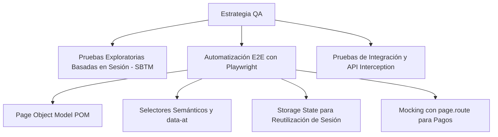

# 📋 Plan de Pruebas Maestro (Master Test Plan)
**Aplicación Objetivo:** Laboratorio de Testing (TestSports by JD)  
**URL:** [https://www.laboratoriodetesting.com/](https://www.laboratoriodetesting.com/)  
**Autor:** Senior QA Automation Engineer  
**Herramienta de Automatización:** Playwright (TypeScript)  
**Versión del Plan:** 1.0  
**Fecha:** Octubre 2026  

---

## 1. Introducción y Objetivos
El presente plan de pruebas define el alcance, estrategia, arquitectura y escenarios para la verificación de calidad funcional y automatización E2E de la plataforma de comercio electrónico **Laboratorio de Testing** (TestSports).

### Objetivos Principales:
1. Validar exhaustivamente las funcionalidades críticas del flujo de compra y gestión de usuario (Autenticación, Búsqueda/Catálogo, Carrito, Favoritos, Checkout).
2. Implementar una suite automatizada robusta, mantenible y escalable utilizando **Playwright** con TypeScript y el patrón **Page Object Model (POM)**.
3. Garantizar pruebas determinísticas y resilientes ante cambios de red mediante mocking inteligente de APIs (`page.route()`) y selectores accesibles/semánticos.
4. Identificar discrepancias de UX/UI, comportamientos erróneos y oportunidades de mejora a través de pruebas exploratorias estructuradas.

---

## 2. Alcance (Scope)

### 2.1 En Alcance (In Scope)
* **Módulo de Autenticación y Autorización**:
  * Login con credenciales válidas e inválidas.
  * Comportamiento reactivo de formularios (botón deshabilitado hasta validar inputs).
  * Toggle de visibilidad de contraseña (eye icon).
  * Modal de recuperación de contraseña (SweetAlert2).
  * Cierre de sesión (`/auth/logout`) e invalidación de sesión.
* **Módulo de Catálogo y Navegación**:
  * Página de inicio (`/`), banners de categorías deportivas y navegación rápida.
  * Listado de productos destacados y secciones especializadas.
  * Vista de detalle de producto (`/products/[slug]`).
* **Módulo de Carrito de Compras (Cart Drawer)**:
  * Control de incremento/decremento de unidades (`-` / `+`).
  * Adición de productos desde catálogo y desde página de detalle.
  * Cálculo dinámico de subtotales, totales y badges de cantidad en Navbar.
  * Apertura/cierre del panel lateral del carrito en viewports Desktop y Mobile.
  * Vaciado y eliminación individual de ítems.
* **Módulo de Favoritos (Wishlist)**:
  * Botón "Agregar a favorito" y comunicación con `POST /favorites`.
  * Visualización y persistencia de favoritos en la página `/whishlist`.
* **Módulo de Mi Cuenta (`/my-account`)**:
  * Renderizado del perfil de usuario (nombre, rol "Estudiante", badges de verificación).
  * Visualización de membresía e historial de órdenes.
* **Módulo de Checkout y Procesamiento de Pago**:
  * Formulario de comprador (nombre, apellido, correo, dirección, país).
  * Formulario de pasarela de pago (nombre titular, número de tarjeta, mes/año de vencimiento, CVV).
  * Manejo de respuestas del backend (`200 OK` vs `400 Bad Request: Tarjeta inválida`).
  * Redirección a `/my-account` y limpieza de `localStorage ('store-cart')`.

### 2.2 Fuera de Alcance (Out of Scope)
* Pasarela bancaria real con cobro monetario real (el entorno opera bajo mock/sandbox formativo).
* Pruebas de estrés y carga masiva a la infraestructura de base de datos.
* Funcionalidades exclusivas del panel administrativo (`/admin`).

---

## 3. Estrategia de Pruebas

### 3.1 Niveles de Prueba
1. **Pruebas E2E (End-to-End)**: Verificación de flujos completos desde la interfaz gráfica (UI) simulando el comportamiento del usuario real.
2. **Pruebas de Integración / Intercepción**: Intercepción de peticiones HTTP en tiempo de ejecución con `page.route()` para validar estados exitosos y escenarios de error (500, 400, timeout) sin depender de terceros.
3. **Pruebas de Regresión Visual y Funcional**: Ejecución continua de la suite ante cada cambio en CI/CD.

### 3.2 Enfoque de Automatización con Playwright
* **Lenguaje y Framework**: TypeScript + `@playwright/test`.
* **Diseño Arquitectónico**:
  * **Page Object Model (POM)**: Centraliza selectores y acciones de cada vista (`LoginPage`, `HomePage`, `ProductPage`, `CartPage`, `CheckoutPage`, `FavoritesPage`).
  * **Selectores Resilientes**: Prioridad en `getByRole`, `getByPlaceholder`, `getByText` y atributos dedicados (`data-at="cart-opener"`).
  * **Gestión de Estado**: Guardado de credenciales y cookies de sesión (`storageState`) para evitar autenticarse repetidamente en cada caso de prueba.
  * **Ejecución Paralela**: `fullyParallel: true` para optimizar tiempos de ejecución.

---

## 4. Matriz de Casos de Prueba (Test Scenarios)

| ID | Módulo | Caso de Prueba | Tipo | Prioridad |
|---|---|---|---|---|
| **TC-AUTH-01** | Autenticación | Login exitoso con credenciales válidas | Positivo / E2E | **P0 (Crítico)** |
| **TC-AUTH-02** | Autenticación | Validación de botón 'Iniciar Sesión' deshabilitado con campos vacíos | Negativo / UI | **P1 (Alto)** |
| **TC-AUTH-03** | Autenticación | Toggle de visibilidad de contraseña (mostrar/ocultar) | Funcional / UI | **P2 (Medio)** |
| **TC-AUTH-04** | Autenticación | Despliegue de modal para recuperación de contraseña | Funcional | **P2 (Medio)** |
| **TC-CAT-01** | Catálogo | Navegación y renderizado de productos destacados en Home | Funcional | **P1 (Alto)** |
| **TC-CAT-02** | Detalle Producto | Visualización de información, precio y reviews de producto | Funcional | **P1 (Alto)** |
| **TC-CAT-03** | Detalle Producto | Contador de cantidad (+ / -) actualiza valor numérico | Funcional | **P1 (Alto)** |
| **TC-CART-01** | Carrito | Adición de producto al carrito y verificación de badge en Navbar | E2E | **P0 (Crítico)** |
| **TC-CART-02** | Carrito | Apertura del drawer del carrito y cálculo exacto de subtotal/total | E2E / Funcional | **P0 (Crítico)** |
| **TC-CART-03** | Carrito | Vaciado y eliminación de productos del carrito | Funcional | **P1 (Alto)** |
| **TC-FAV-01** | Favoritos | Adición de producto a favoritos desde vista de detalle | E2E | **P1 (Alto)** |
| **TC-FAV-02** | Favoritos | Persistencia y listado en la vista `/whishlist` | E2E | **P1 (Alto)** |
| **TC-CHK-01** | Checkout | Navegación al checkout con productos en el carrito | E2E | **P0 (Crítico)** |
| **TC-CHK-02** | Checkout | Validación de campos obligatorios (botón 'Completar Pago' deshabilitado) | Negativo / UI | **P1 (Alto)** |
| **TC-CHK-03** | Checkout | Manejo de rechazo por tarjeta inválida (modal SweetAlert con error 400) | Negativo / Backend | **P1 (Alto)** |
| **TC-CHK-04** | Checkout | Pago completado con éxito (Mock 200 OK), modal de confirmación y redirección | Positivo / E2E | **P0 (Crítico)** |
| **TC-ACC-01** | Mi Cuenta | Renderizado correcto de perfil, insignias de verificación y estado | Funcional | **P2 (Medio)** |

---

## 5. Criterios de Aceptación y Salida
1. **Tasa de Aprobación**: 100% de los casos P0 (Smoke/Sanity) pasando sin fallos.
2. **Flakiness Zero**: Cero fallas intermitentes mediante el uso adecuado de auto-waits y assertions web-first (`expect(locator).toBeVisible()`).
3. **Tiempos de Ejecución**: Suite completa ejecutándose en menos de 60 segundos en paralelo.
4. **Reporte Generado**: Reporte HTML de Playwright con trazas (`trace.zip`), capturas y logs de red adjuntos ante fallos.
